# Dependency Graph: CLAIM-LRC-000007

Generated: 2026-02-26T01:48:46Z

## Nodes
- S1: theorem:
- S2: theorem:
- S3: theorem:
- S4: theorem:
- S5: proposition:
- S6: theorem:
- S7: theorem:
- S8: theorem:
- S9: lemma:
- S10: lemma:
- S11: corollary:
- S12: proposition:
- S13: corollary:
- S14: proposition:
- S15: corollary:
- S16: theorem:
- S17: theorem:
- S18: corollary:
- S19: theorem:

## Edges
- S1 -> S2 (sequential_dependency)
- S2 -> S3 (sequential_dependency)
- S3 -> S4 (sequential_dependency)
- S4 -> S5 (sequential_dependency)
- S5 -> S6 (sequential_dependency)
- S6 -> S7 (sequential_dependency)
- S7 -> S8 (sequential_dependency)
- S8 -> S9 (sequential_dependency)
- S9 -> S10 (sequential_dependency)
- S10 -> S11 (sequential_dependency)
- S11 -> S12 (sequential_dependency)
- S12 -> S13 (sequential_dependency)
- S13 -> S14 (sequential_dependency)
- S14 -> S15 (sequential_dependency)
- S15 -> S16 (sequential_dependency)
- S16 -> S17 (sequential_dependency)
- S17 -> S18 (sequential_dependency)
- S18 -> S19 (sequential_dependency)
- S1 -> S2 (formal_reference)
- S2 -> S3 (formal_reference)
- S3 -> S4 (formal_reference)
- S4 -> S5 (formal_reference)
- S5 -> S6 (formal_reference)
- S6 -> S7 (formal_reference)
- S7 -> S8 (formal_reference)
- S8 -> S9 (formal_reference)
- S9 -> S10 (formal_reference)
- S10 -> S11 (formal_reference)
- S11 -> S12 (formal_reference)
- S12 -> S13 (formal_reference)
- S13 -> S14 (formal_reference)
- S14 -> S15 (formal_reference)
- S15 -> S16 (formal_reference)
- S16 -> S17 (formal_reference)
- S17 -> S18 (formal_reference)
- S18 -> S19 (formal_reference)

## Machine Graph (Mermaid)

```mermaid
graph TD
  S1["theorem:"]
  S2["theorem:"]
  S3["theorem:"]
  S4["theorem:"]
  S5["proposition:"]
  S6["theorem:"]
  S7["theorem:"]
  S8["theorem:"]
  S9["lemma:"]
  S10["lemma:"]
  S11["corollary:"]
  S12["proposition:"]
  S13["corollary:"]
  S14["proposition:"]
  S15["corollary:"]
  S16["theorem:"]
  S17["theorem:"]
  S18["corollary:"]
  S19["theorem:"]
  S1 -->|sequential_dependency| S2
  S2 -->|sequential_dependency| S3
  S3 -->|sequential_dependency| S4
  S4 -->|sequential_dependency| S5
  S5 -->|sequential_dependency| S6
  S6 -->|sequential_dependency| S7
  S7 -->|sequential_dependency| S8
  S8 -->|sequential_dependency| S9
  S9 -->|sequential_dependency| S10
  S10 -->|sequential_dependency| S11
  S11 -->|sequential_dependency| S12
  S12 -->|sequential_dependency| S13
  S13 -->|sequential_dependency| S14
  S14 -->|sequential_dependency| S15
  S15 -->|sequential_dependency| S16
  S16 -->|sequential_dependency| S17
  S17 -->|sequential_dependency| S18
  S18 -->|sequential_dependency| S19
  S1 -->|formal_reference| S2
  S2 -->|formal_reference| S3
  S3 -->|formal_reference| S4
  S4 -->|formal_reference| S5
  S5 -->|formal_reference| S6
  S6 -->|formal_reference| S7
  S7 -->|formal_reference| S8
  S8 -->|formal_reference| S9
  S9 -->|formal_reference| S10
  S10 -->|formal_reference| S11
  S11 -->|formal_reference| S12
  S12 -->|formal_reference| S13
  S13 -->|formal_reference| S14
  S14 -->|formal_reference| S15
  S15 -->|formal_reference| S16
  S16 -->|formal_reference| S17
  S17 -->|formal_reference| S18
  S18 -->|formal_reference| S19
```

