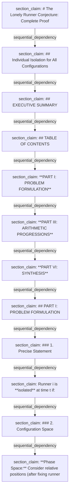

# Dependency Graph: CLAIM-LRC-000018

Generated: 2026-02-26T01:48:46Z

## Nodes
- S1: section_claim: # The Lonely Runner Conjecture: Complete Proof
- S2: section_claim: ## Individual Isolation for All Configurations
- S3: section_claim: ## EXECUTIVE SUMMARY
- S4: section_claim: ## TABLE OF CONTENTS
- S5: section_claim: **PART I: PROBLEM FORMULATION**
- S6: section_claim: **PART III: ARITHMETIC PROGRESSIONS**
- S7: section_claim: **PART VI: SYNTHESIS**
- S8: section_claim: ## PART I: PROBLEM FORMULATION
- S9: section_claim: ### 1. Precise Statement
- S10: section_claim: Runner i is **isolated** at time t if:
- S11: section_claim: ### 2. Configuration Space
- S12: section_claim: **Phase Space:** Consider relative positions (after fixing runner 1 at origin):

## Edges
- S1 -> S2 (sequential_dependency)
- S2 -> S3 (sequential_dependency)
- S3 -> S4 (sequential_dependency)
- S4 -> S5 (sequential_dependency)
- S5 -> S6 (sequential_dependency)
- S6 -> S7 (sequential_dependency)
- S7 -> S8 (sequential_dependency)
- S8 -> S9 (sequential_dependency)
- S9 -> S10 (sequential_dependency)
- S10 -> S11 (sequential_dependency)
- S11 -> S12 (sequential_dependency)

## Machine Graph (Mermaid)

