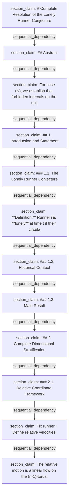

# Dependency Graph: CLAIM-LRC-000022

Generated: 2026-02-26T01:48:46Z

## Nodes
- S1: section_claim: # Complete Resolution of the Lonely Runner Conjecture
- S2: section_claim: ## Abstract
- S3: section_claim: For case (iv), we establish that forbidden intervals on the unit circle cannot achieve full coverage through a combination of:
- S4: section_claim: ## 1. Introduction and Statement
- S5: section_claim: ### 1.1. The Lonely Runner Conjecture
- S6: section_claim: **Definition:** Runner i is **lonely** at time t if their circular distance to every other runner is at least 1/n:
- S7: section_claim: ### 1.2. Historical Context
- S8: section_claim: ### 1.3. Main Result
- S9: section_claim: ## 2. Complete Dimensional Stratification
- S10: section_claim: ### 2.1. Relative Coordinate Framework
- S11: section_claim: Fix runner i. Define relative velocities:
- S12: section_claim: The relative motion is a linear flow on the (n-1)-torus:

## Edges
- S1 -> S2 (sequential_dependency)
- S2 -> S3 (sequential_dependency)
- S3 -> S4 (sequential_dependency)
- S4 -> S5 (sequential_dependency)
- S5 -> S6 (sequential_dependency)
- S6 -> S7 (sequential_dependency)
- S7 -> S8 (sequential_dependency)
- S8 -> S9 (sequential_dependency)
- S9 -> S10 (sequential_dependency)
- S10 -> S11 (sequential_dependency)
- S11 -> S12 (sequential_dependency)

## Machine Graph (Mermaid)

