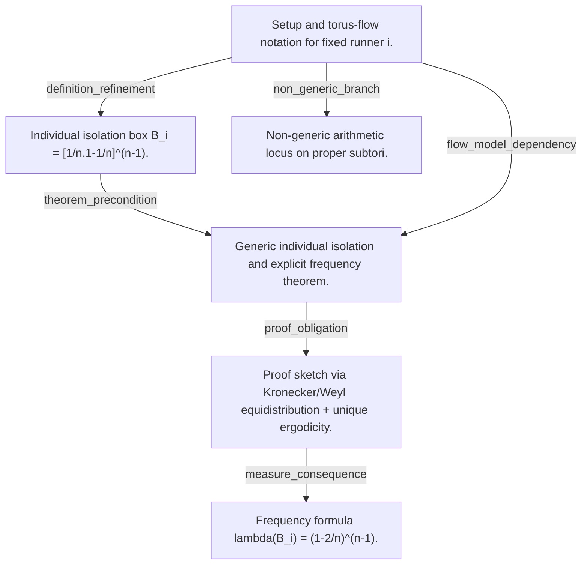

# Dependency Graph: CLAIM-LRC-000030

Generated: 2026-02-26T03:00:40Z

## Nodes
- D1: Setup and torus-flow notation for fixed runner i.
- D2: Individual isolation box B_i = [1/n,1-1/n]^(n-1).
- T1: Generic individual isolation and explicit frequency theorem.
- P1: Proof sketch via Kronecker/Weyl equidistribution + unique ergodicity.
- C1: Frequency formula lambda(B_i) = (1-2/n)^(n-1).
- N1: Non-generic arithmetic locus on proper subtori.

## Edges
- D1 -> D2 (definition_refinement)
- D2 -> T1 (theorem_precondition)
- D1 -> T1 (flow_model_dependency)
- T1 -> P1 (proof_obligation)
- P1 -> C1 (measure_consequence)
- D1 -> N1 (non_generic_branch)

## Machine Graph (Mermaid)

